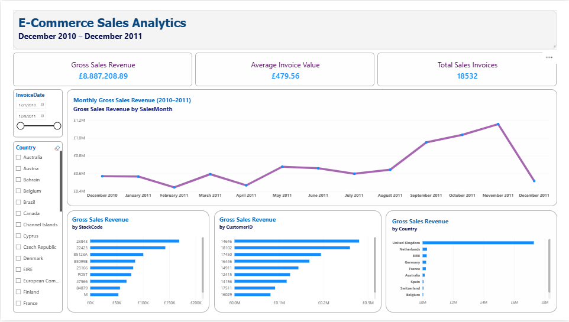
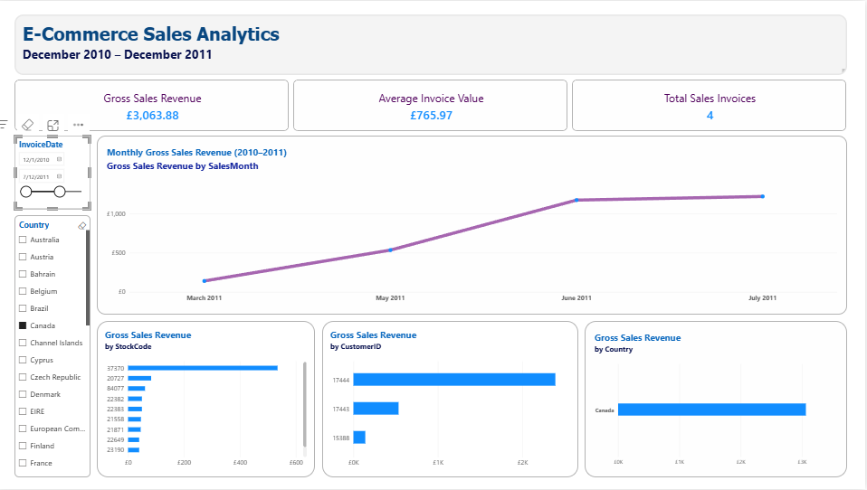

# E-Commerce Sales Analytics

An end-to-end data analytics project using the UCI Online Retail dataset. The project demonstrates a complete workflow, from data exploration and cleaning with Python to relational database storage, SQL business analysis, and interactive Power BI reporting.

Python and MySQL run in separate Docker containers managed by Docker Compose.

## Project Overview

The objective is to explore historical e-commerce transactions and identify useful insights about sales performance, customer purchasing behavior, and product revenue.

The project covers:

- Data ingestion, exploration, and cleaning using Python and Pandas.
- Relational database design and storage using MySQL.
- Data loading with SQLAlchemy.
- SQL-based business analysis.
- Interactive business intelligence reporting using Power BI.
- Containerized development using Docker Compose.

**Current status:** The initial end-to-end analytics workflow is complete, including data cleaning, database creation, data loading, six SQL analyses, and an interactive Power BI dashboard.

## Dataset

**Source:** [UCI Online Retail Dataset](https://archive.ics.uci.edu/dataset/352/online+retail)

The dataset contains historical transactions from a UK-based online retailer between December 2010 and December 2011.

The original dataset contains 541,909 transaction records and the following columns:

| Column | Description |
|---|---|
| InvoiceNo | Invoice identifier |
| StockCode | Product identifier |
| Description | Product description |
| Quantity | Number of units recorded |
| InvoiceDate | Date and time of the transaction |
| UnitPrice | Unit price in GBP |
| CustomerID | Customer identifier, when available |
| Country | Customer's country of residence |

### Dataset Processing Summary

| Metric | Count |
|---|---:|
| Original records | 541,909 |
| Exact duplicate records removed | 5,268 |
| Cleaned transaction records | 536,641 |
| Unique known customers | 4,372 |
| Unique product identifiers | 4,070 |
| Transactions with missing CustomerID | 135,037 |

The cleaned dataset is saved as:

`data/processed/online_retail_cleaned.csv`

## Technology Stack

| Technology | Purpose |
|---|---|
| Python 3.11 | Data processing and pipeline development |
| Pandas | Data exploration and cleaning |
| NumPy | Numerical operations |
| MySQL 8.4 | Relational database |
| SQL | Business analysis |
| SQLAlchemy | Python-to-MySQL connectivity |
| PyMySQL | MySQL database driver |
| Docker | Containerization |
| Docker Compose | Multi-container environment |
| Power BI Desktop | Interactive dashboards |
| Git and GitHub | Version control and project hosting |

## Project Architecture

The project follows this workflow:

```text
UCI Online Retail Dataset
          |
          v
      Raw Dataset
          |
          v
    Python + Pandas
    Data Exploration
    Data Cleaning
    Transaction Classification
          |
          v
     Cleaned CSV File
          |
          v
    Python + SQLAlchemy
          |
          v
       MySQL 8.4
    -------------------
    |    Customers    |
    |    Products     |
    |    Transactions |
    -------------------
          |
          v
      SQL Analytics
          |
          v
    Power BI Dashboard
```

Docker Compose manages the Python application and MySQL database as separate services.

## Data Cleaning and Preparation

Data cleaning is performed using Python and Pandas.

### 1. Duplicate Removal

The original dataset contained 5,268 exact duplicate records.

These duplicates were removed, reducing the dataset from 541,909 to 536,641 rows.

### 2. Missing Values

Missing values were investigated before deciding how to handle them.

In particular, 135,037 cleaned records have missing `CustomerID` values.

These transactions were preserved because they still contain useful sales and product information.

Missing CustomerIDs are stored as SQL `NULL` values in the transactions table. No artificial customer identifiers were generated.

### 3. Transaction Classification

A new column, `TransactionType`, was introduced to distinguish different transaction categories.

| Transaction Type | Records |
|---|---:|
| SALE | 524,878 |
| CANCELLATION | 9,251 |
| ADJUSTMENT | 1,336 |
| ZERO_PRICE | 1,174 |
| BAD_DEBT | 2 |
| **Total** | **536,641** |

This classification allows business analyses to include or exclude particular transaction types depending on the metric being calculated.

For example, gross sales revenue is calculated using only transactions classified as `SALE`.

### 4. Data Type Preparation

Identifiers such as `InvoiceNo`, `StockCode`, and `CustomerID` are handled as strings.

`InvoiceDate` is converted into a datetime representation before loading it into MySQL.

The original product identifiers are preserved, including differences in capitalization.

## Database Design

The cleaned dataset is stored in a relational MySQL database named `ecommerce`.

The database contains three tables.

### Customers

Stores unique known customer identifiers.

| Column | Type | Constraint |
|---|---|---|
| CustomerID | VARCHAR(20) | Primary Key |

### Products

Stores unique product identifiers.

| Column | Type | Constraint |
|---|---|---|
| StockCode | VARCHAR(20) | Primary Key |

The `StockCode` column uses the case-sensitive collation `utf8mb4_0900_as_cs`.

### Transactions

Stores the cleaned transaction records.

| Column | Type | Description |
|---|---|---|
| TransactionID | BIGINT | Auto-increment primary key |
| InvoiceNo | VARCHAR(10) | Invoice identifier |
| StockCode | VARCHAR(20) | Foreign key referencing products |
| Description | VARCHAR(100) | Product description |
| Quantity | INT | Recorded quantity |
| InvoiceDate | DATETIME | Transaction date and time |
| UnitPrice | DECIMAL(12,3) | Unit price |
| CustomerID | VARCHAR(20) | Nullable foreign key referencing customers |
| Country | VARCHAR(50) | Customer country |
| TransactionType | VARCHAR(20) | Transaction classification |

### Relationships

- One customer can be associated with multiple transaction records.
- One product can appear in multiple transaction records.
- Each transaction record references one product.
- A transaction can have a missing customer identifier.

`Description` remains in the transactions table because the same StockCode can have multiple descriptions in the original data.

`Country` also remains in transactions rather than customers, preserving the country value recorded for each transaction.

The full database schema is available in [`sql/schema.sql`](sql/schema.sql).

## Technical Challenges and Solutions

### Case-Sensitive Product Identifiers

During product loading, MySQL raised a duplicate primary-key error.

Investigation revealed that Pandas treated identifiers such as `15056BL` and `15056bl` as different strings, while MySQL's default case-insensitive collation treated them as equal.

**Solution:**

The `StockCode` columns in both `products` and `transactions` were configured with the case-sensitive collation `utf8mb4_0900_as_cs`.

This preserves the original identifiers and allows them to coexist in the database.

### Missing Customer Identifiers

Some transactions do not contain a CustomerID.

Instead of deleting these records, the database permits `NULL` in `transactions.CustomerID`.

The customers table contains only known, unique identifiers.

### Preventing Accidental Duplicate Imports

The Python loading script checks the number of records already present in each database table.

If the tables already contain the expected row counts, the script skips importing.

If the database is partially populated or the counts do not match, the script stops rather than automatically appending potentially duplicate records.

This provides a basic safeguard against accidental repeated imports.

## Running the Project

### Prerequisites

- Docker Desktop with Docker Compose
- Git
- The UCI Online Retail dataset

### 1. Clone the Repository

```bash
git clone https://github.com/mariem-chatti/ecommerce-sales-analytics.git
cd ecommerce-sales-analytics
```

### 2. Configure Environment Variables

Create a `.env` file with the MySQL configuration expected by `docker-compose.yml`.

Do not commit `.env` files containing passwords or other credentials.

### 3. Start Docker Services

```bash
docker compose up -d --build
```

### 4. Prepare the Dataset

Place the original dataset in the appropriate raw-data directory and execute the project's data preparation and cleaning scripts.

The loading script expects the cleaned dataset at:

```text
data/processed/online_retail_cleaned.csv
```

### 5. Create the Database Tables

The SQL schema is stored in `sql/schema.sql`.

With the MySQL service running, the schema can be executed using PowerShell:

```powershell
Get-Content .\sql\schema.sql -Raw | docker compose exec -T mysql mysql -u analyst -p ecommerce
```

Enter the database password when prompted.

The schema creates the `customers`, `products`, and `transactions` tables, including their primary keys, foreign keys, and product-code collations.

### 6. Load the Cleaned Data

```bash
docker compose run --rm python-app python src/load_to_mysql.py
```

The script connects to MySQL, prepares the customer, product, and transaction data, and imports it into the corresponding tables.

### 7. Access MySQL

```bash
docker compose exec mysql mysql -u analyst -p ecommerce
```

### 8. Validate the Database

Run:

```sql
SELECT COUNT(*) FROM customers;
SELECT COUNT(*) FROM products;
SELECT COUNT(*) FROM transactions;
```

Expected results:

| Table | Records |
|---|---:|
| customers | 4,372 |
| products | 4,070 |
| transactions | 536,641 |

## SQL Business Analytics

SQL business analysis is performed directly against the cleaned transaction data stored in MySQL.

The queries are available in [`sql/sales_Analysis.sql`](sql/sales_Analysis.sql).

Detailed results, methodology, interpretations, and limitations are documented in [`docs/sales_analysis.md`](docs/sales_analysis.md).

### Completed Analyses

| # | Analysis | Purpose |
|---|---|---|
| 1 | Gross Sales Revenue | Calculate total gross sales revenue |
| 2 | Monthly Sales Performance | Analyze revenue and invoice trends over time |
| 3 | Average Invoice Value | Understand revenue growth relative to invoice volume |
| 4 | Top 10 StockCodes by Revenue | Identify the highest-revenue StockCodes |
| 5 | Revenue by Country | Compare sales performance by customer country |
| 6 | Top 10 Customers | Identify customers contributing the most gross revenue |

### Key Business Findings

| Metric | Finding |
|---|---|
| Total gross sales revenue | £10,642,110.80 |
| Highest-revenue month | November 2011 (£1,503,866.78) |
| Highest monthly invoice count | November 2011 (2,769 invoices) |
| Highest-revenue customer country | United Kingdom (£9,001,744.09) |
| Highest-revenue identified customer | Customer 14646 (£280,206.02) |
| Highest-revenue StockCode | DOT (£206,248.77) |

### Business Insights

**Revenue trends:** Gross sales revenue increased significantly between September and November 2011. This growth was accompanied by an increase in invoice counts and a decrease in average invoice value.

**Geographic concentration:** The United Kingdom accounted for approximately 84.6% of gross sales revenue, indicating that sales were heavily concentrated in the domestic market.

**Customer behavior:** Customer 14646 generated the highest gross revenue among identified customers. However, the customer with the highest revenue was not the customer with the most invoices.

**Product performance:** The initial product ranking includes identifiers such as `DOT`, `POST`, and `M`, which may represent charges rather than physical products. Therefore, the ranking should not yet be interpreted as a definitive list of the best-selling merchandise.

### Analysis Scope and Limitations

All current gross sales analyses include only transactions classified as `SALE`.

Cancellations, adjustments, and other transaction types are excluded from these calculations.

Gross sales revenue should not be confused with net revenue or profit.

The dataset ends on December 9, 2011, making December 2011 an incomplete reporting month.

For detailed findings, see [`docs/sales_analysis.md`](docs/sales_analysis.md).

## Power BI Dashboard

An interactive Power BI dashboard was developed using the cleaned transaction data stored in MySQL.

### Dashboard Components

| Component | Purpose |
|---|---|
| Gross Sales Revenue | Display total gross sales revenue |
| Average Invoice Value | Show average revenue per sales invoice |
| Total Sales Invoices | Display the number of distinct sales invoices |
| Monthly Revenue Trend | Explore changes in monthly gross revenue |
| Revenue by Country | Compare revenue across customer countries |
| Top 10 StockCodes | Identify the highest-revenue product identifiers |
| Top 10 Customers | Identify the highest-revenue identified customers |

### Interactive Filters

The dashboard includes two slicers:

- **Invoice Date:** Filter the reporting period.
- **Country:** Explore sales performance for selected customer countries.

The slicers allow users to explore different periods and customer markets. The visuals update dynamically based on the selected filters.

### Dashboard Preview

The following screenshots show the main dashboard and an example of the dashboard with filters applied.

**Main Dashboard**



**Dashboard with Filters Applied**



### Interactive Power BI Report

The complete Power BI report is included in the repository:

[**Download the Power BI Dashboard (.pbix)**](dashboard/ecommerce_sales_dashboard.pbix)

The `.pbix` file can be opened using Power BI Desktop to explore the interactive report.

**Note:** The report was developed using a local MySQL database. To refresh the data, users may need to configure their own MySQL connection and credentials. The screenshots provide static previews without requiring a database connection.

## Project Status

**Version 1 — Sales Analytics: Initial workflow completed**

### Completed

- Dataset exploration and cleaning.
- Duplicate removal and missing-value handling.
- Transaction classification.
- Dockerized Python and MySQL environment.
- Relational database schema.
- Data loading using SQLAlchemy.
- Database validation.
- Six SQL business analyses.
- Initial business insights and SQL documentation.
- Interactive Power BI dashboard.
- Revenue, customer, and product visualizations.
- Date and country slicers.

### Potential Future Improvements

- Customer segmentation.
- Additional exploratory statistics.
- More detailed cancellation and return analysis.
- Refined merchandise-only product rankings.
- Additional data-quality validation.

## Future Extension — Version 2

The project may later be extended with:

- Dimensional modeling.
- Data warehousing concepts.
- HDFS.
- Apache Hive.

The goal of Version 2 is to explore how the analytical workflow can evolve from a relational database implementation toward a larger-scale data platform.